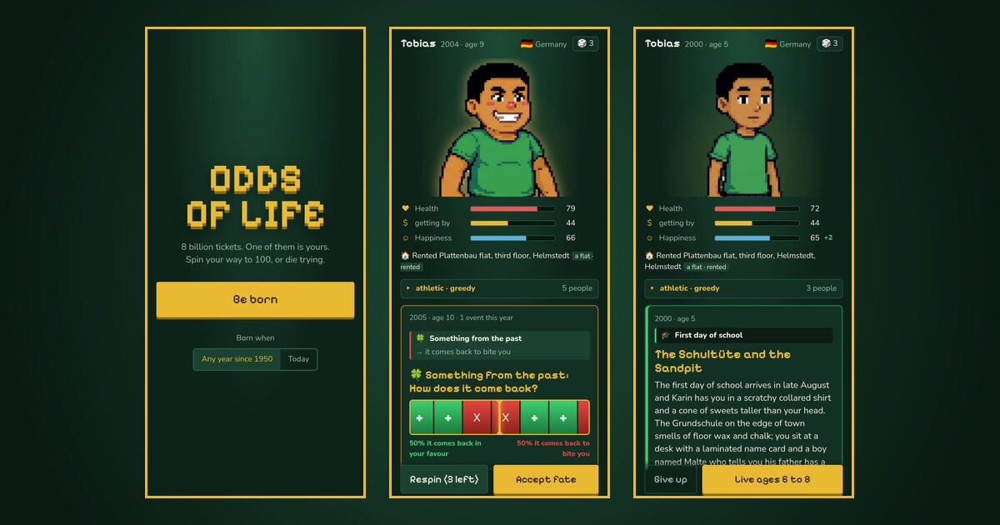
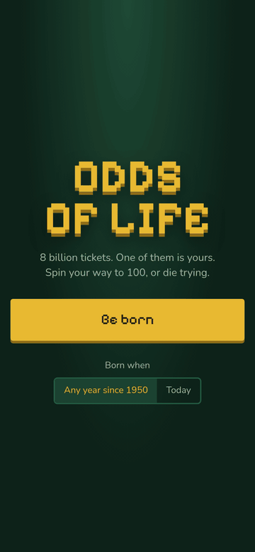
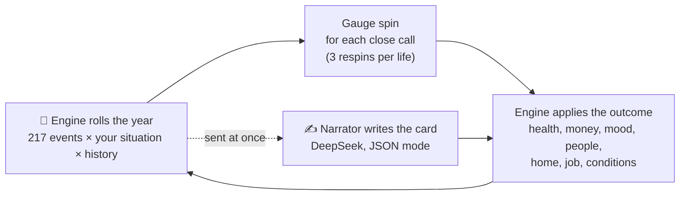

<p align="center">
  
</p>

<h1 align="center">Odds of Life</h1>

<p align="center">
  <b>8 billion tickets. One of them is yours.</b><br>
  A life lottery where real-world odds decide your fate and an AI narrator writes every year of it.
</p>

<p align="center">
  <a href="https://solvai.github.io/odds-of-life/"><b>▶ Play now in your browser</b></a>
  &nbsp;·&nbsp;
  <a href="https://solvai.itch.io/odds-of-life">itch.io</a>
  &nbsp;·&nbsp;
  <a href="#where-the-odds-come-from">Where the odds come from</a>
  &nbsp;·&nbsp;
  <a href="#run-it-locally">Run it locally</a>
</p>

<p align="center">
  <a href="https://github.com/SolvAI/odds-of-life/stargazers"></a>
  <a href="https://github.com/SolvAI/odds-of-life/actions/workflows/pages.yml"></a>
  <a href="LICENSE"></a>
</p>

You are born somewhere on Earth, drawn the way real babies are: in the game, 1 birth in 4 lands in India, 1 in 26 in the United States and 1 in 1,800 in Norway. Your country, family wealth, health and birth year (any year since 1950) are set before you take a breath. Then you live one year at a time. Real-world odds decide what happens to you, a gauge spin settles the close calls, and a language model writes your life as it happens: the town, the slang, the prices, the people who stay and the ones who don't. Try to reach 100. Most people won't.

<p align="center">
  
</p>

> ⭐ **If a life in here made you laugh or wince, star the repo.** Stars are how a small project like this gets found, and every one of them keeps it going.

## Where the odds come from

The 41 countries in the game cover about 70% of the world's births. Each one carries 21 figures, most of them from public datasets:

| What it decides | Figure | Source |
| --- | --- | --- |
| Where you are born | births per year | [UN World Population Prospects 2024](https://population.un.org/wpp/) |
| How long people live there | life expectancy, births per woman | UN WPP via the [World Bank](https://data.worldbank.org/indicator/SP.DYN.LE00.IN) |
| How rich the country is | income group | [World Bank country classifications](https://datahelpdesk.worldbank.org/knowledgebase/articles/906519) |
| Murder and road deaths | deaths per 100k | [UNODC](https://dataunodc.un.org/), [WHO road safety report](https://www.who.int/publications/i/item/9789240086517) |
| Dying in childbirth | maternal deaths per 100k births, 2023 | [WHO / UN MMEIG](https://data.worldbank.org/indicator/SH.STA.MMRT) |
| HIV, child marriage, smoking, obesity | prevalence | [UNAIDS](https://aidsinfo.unaids.org/), [UNICEF](https://data.unicef.org/topic/child-protection/child-marriage/), [WHO](https://www.who.int/data/gho) |
| Prison | prisoners per 100k | [World Prison Brief](https://www.prisonstudies.org/world-prison-brief-data) |
| Disasters, malaria, conflict, heat | risk level 0 to 3 | scored by hand |

On top of that sit 100 moments of real history since 1950 that bend the odds where and when you live: the Great Chinese Famine, the Biafran war, the Soviet collapse, the 2008 crash, COVID. Born after 2026? Each run generates its own future, with recessions, pandemics, an automation wave and a slowly heating climate.

The country table is a hand-built snapshot of 2019 to 2024 figures, and you can check it yourself. `python3 scripts/check-data.py` compares it with the live World Bank API. Today the median gap is 0.9% for life expectancy, 2.9% for fertility and zero for maternal mortality.

**From figures to events.** 217 events, from malaria and motorbike crashes to a scholarship or a lottery win, each have a yearly probability built from those figures and published rates, then scaled by your situation: age, wealth, health, job, home, country, personality traits and the year itself. A 10,000-life simulation keeps the result honest (`npm run sim`):

| Starting point | Median age at death |
| --- | --- |
| High-income country | 76 |
| Upper-middle income | 71 |
| Lower-middle income | 64 |
| Low income | 58 |
| Born poor (the hard start) | 59 |

Lives start anywhere from 1950 to today, so these sit below current life expectancy, as they should.

## One year, step by step



The engine owns every number and the model owns every word. Dice decide who dies, who gets rich and who gets deported. The narrator receives the outcome and has to write it, and it can't overrule the dice.

## Under the hood

- **Long memory on a short prompt.** Every card also returns structured records: a 120-word rolling summary of the life, up to four open storylines, notes on each named person, and conditions gained or lost. The next prompt carries those records plus the last two cards. That is enough for the loose stair rail of a toddler's first walk-up to break their wrist at six, and for a high-school bully to keep coming back for more.
- **Zero waiting, mostly.** The next year is rolled and sent to the narrator while you are still reading or watching the gauge, so the 4 seconds of generation hide behind the animation.
- **Cheap to run.** One measured 68-year life: 67 calls, 154k prompt tokens and 31k output tokens, a few cents on DeepSeek.
- **A public endpoint built to be abused.** The browser never sees the API key. A Cloudflare Worker ([`worker/`](worker/src/index.ts)) holds it and owns the system prompt and model settings, so the endpoint only works as this game's narrator. On top of that it checks the request shape and size, refuses origins other than the game's own, and enforces a per-minute burst limit, a per-visitor daily cap and a global daily budget. Visitor IPs are only ever stored as hashes that change every day.
- **Testable without spending a cent.** `npm run sim` plays 10,000 lives with no model at all. `npm run story` plays one full life with DeepSeek and writes a readable report: see [`reports/`](reports/).

## A taste

From [Tesfaye's life](reports/story-5150.md), born in Addis Ababa in 1978, the second year of the Derg, died at 68 in a damp basement in Padua with €41,000 in a tin he never opened:

> **Basement Resident Dies; Shift Supervisor Notices After Three Days**
>
> *Epitaph:* "He counted boxes. The boxes did not count him."

Fair warning: the tone is dark and it doesn't look away. Poverty, disease, war, crime and awful relatives are all part of the odds.

## Run it locally

```bash
git clone https://github.com/SolvAI/odds-of-life.git
cd odds-of-life
npm install
echo "DEEPSEEK_API_KEY=your-key" > .env   # optional: without it, cards fall back to plain text
npm run dev                                 # http://localhost:5173
```

| Command | What it does |
| --- | --- |
| `npm run sim` | 10,000 lives, no model: lifespans, causes of death, event frequencies |
| `npm run story [seed]` | one full life with DeepSeek, written to `reports/story-<seed>.md` |
| `python3 scripts/check-data.py` | the country table against the World Bank API |
| `npm run build` | static build in `dist/`, ready for any host |

### Your own narrator

The live game talks to a Cloudflare Worker on the free plan. To run your own:

```bash
cd worker && npm install
npx wrangler login
npx wrangler deploy
npx wrangler secret put DEEPSEEK_API_KEY
```

Then build the game with `VITE_NARRATOR_URL=https://<your-worker>.workers.dev/narrate`. Allowed origins and daily limits live in [`worker/wrangler.toml`](worker/wrangler.toml).

## Project map

```
src/engine/   the rules: births, years, choices, effects, history and generated futures
src/data/     41 countries, 217 events, 75 conditions, 21 traits, 100 historical moments
src/llm/      prompts, the narrator request, parsing and offline fallbacks
src/ui/       React screens, the gauge, avatars with skin tones recoloured at runtime
worker/       the Cloudflare Worker that holds the key and enforces the limits
scripts/      simulation, story reports, data check, sprite pipeline
```

## Credits

- Pixel-art characters: 108 sprites generated with Nano Banana Pro through Higgsfield, skin tones recoloured in code.
- Narration: DeepSeek.
- Fonts: Pixelify Sans and Nunito.

Released under the [MIT license](LICENSE).

<p align="center"><b>Got a good death out of it? <a href="https://github.com/SolvAI/odds-of-life/stargazers">⭐ Star Odds of Life</a> so the next player can find it.</b></p>
